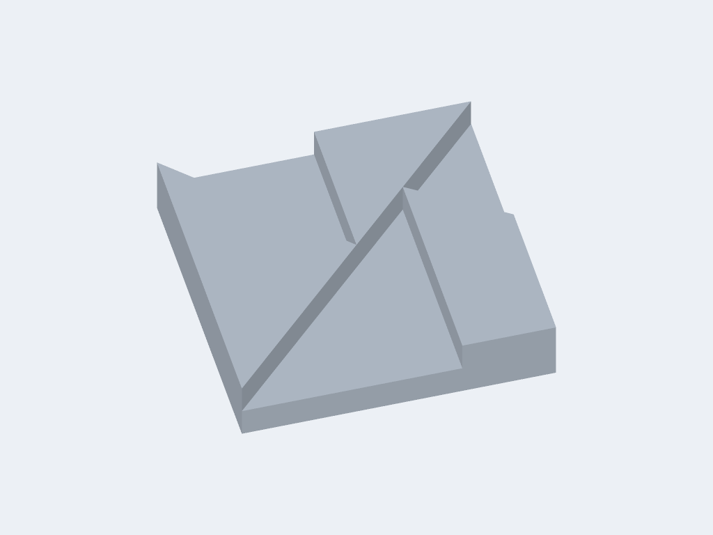
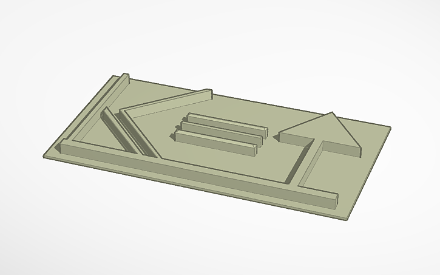
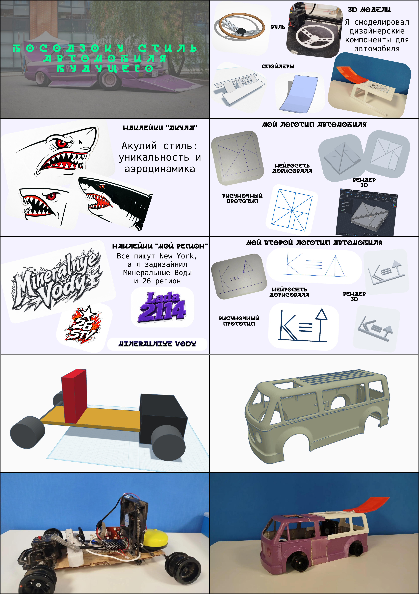
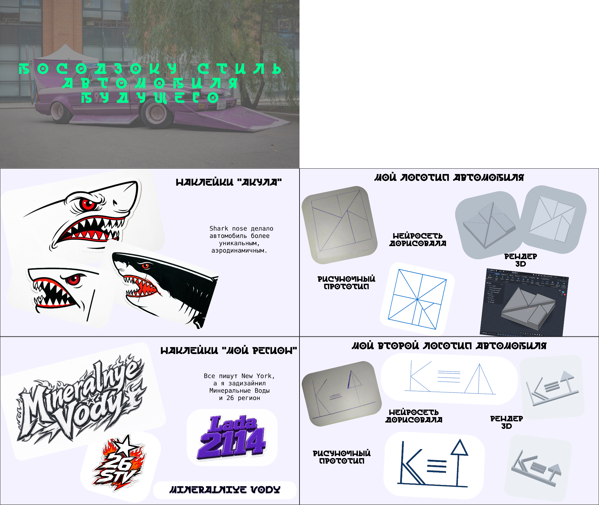
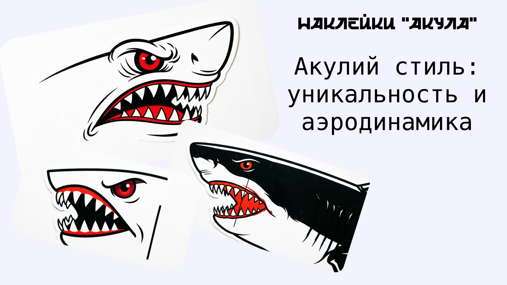
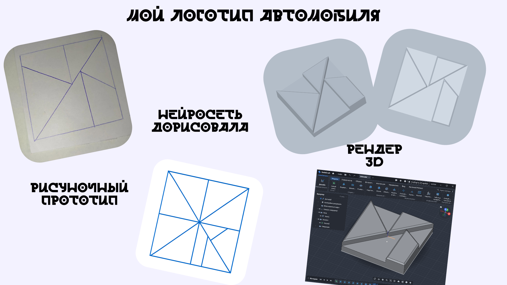
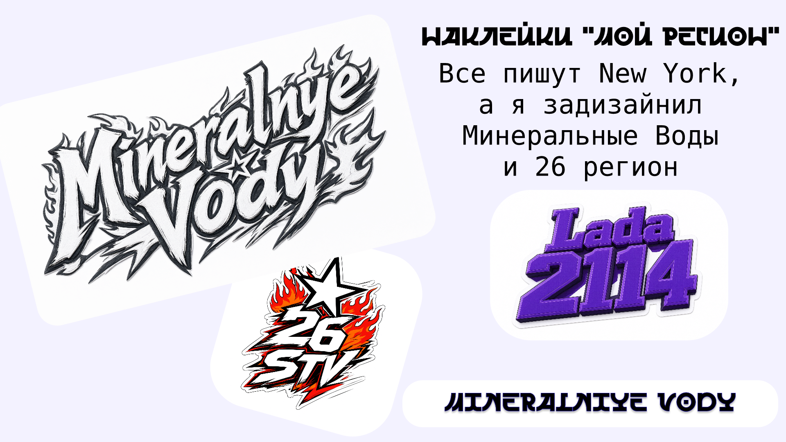
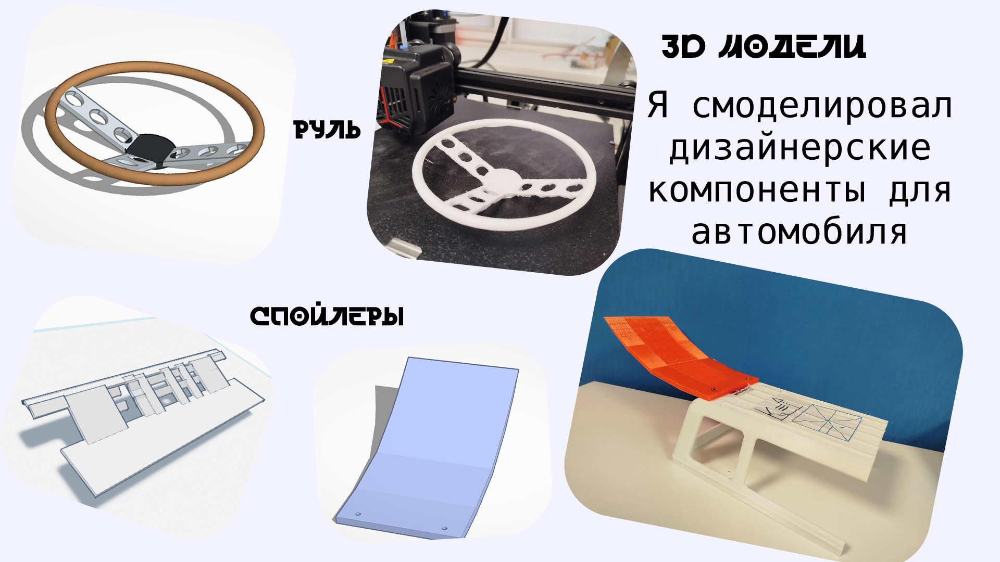

# 🚗 Smart Auto
### Автомобиль будущего · Инженеры транспорта

**Smart Auto** — концепт автомобиля будущего с уникальным авторским дизайном. Проект включает 3D-моделирование, детали для 3D-печати, собственные логотипы и коллекцию автомобильных наклеек.

---

## 📸 Автомобиль

<p align="center">
  
  <br><sub>Главный вид автомобиля с авторскими наклейками</sub>
</p>

| Фотография | Описание |
|---|---|
|  | **Вид спереди** |
|  | **Интерьер автомобиля** |
|  | **Вид сзади, багажник открыт** |
|  | **Вид сбоку, багажник открыт** |
|  | **Открытый багажник — ракурс 2** |
|  | **Открытый багажник — ракурс 3** |
|  | **Дизайн кузова — ракурс 2** |
|  | **Дизайн кузова — ракурс 3** |

---

## 🧩 3D-модели и STL

Каждое изображение сопоставлено с соответствующей 3D-моделью. Нажми **«Скачать STL»**, чтобы получить файл для 3D-печати.

### Декоративные элементы

| Превью | Название | Файл |
|---|---|---|
|  | **Спойлер №1** | [⬇ Скачать STL](<STL/декор/классный спойлер.stl>) |
|  | **Спойлер №2** | [⬇ Скачать STL](<STL/декор/крутой спойлер (1).stl>) |
|  | **Авторский руль** | [⬇ Скачать STL](<STL/декор/руль классный (2).stl>) |

### Логотипы

| Превью | Название | Файл |
|---|---|---|
|  | **Логотип №1** | [⬇ Скачать STL](<STL/Лого/logo1.stl>) |
|  | **Логотип №2** | [⬇ Скачать STL](<STL/Лого/logo2.stl>) |

### Корпус и механизмы

| Деталь | Формат | Скачать |
|---|---|---|
| **Лицевая часть корпуса** | STL | [⬇ Скачать](<STL/Корпус/лицевая часть.stl>) |
| **Лицевая часть корпуса** | 3MF | [⬇ Скачать](<STL/Корпус/лицевая часть.3mf>) |
| **Мотор, колёса и вентилятор** | STL | [⬇ Скачать](<STL/Корпус/мотор, колеса, вентилятор.stl>) |

---

## 🎨 Авторские наклейки

### Коллекция «Акула»

| Изображение | Название |
|---|---|
|  | **Акула — вариант 1** |
|  | **Акула — вариант 2** |
|  | **Акула — вариант 3** |

### Стиль Bosozoku

| Изображение | Название |
|---|---|
|  | **Bosozoku — вариант 1** |
|  | **Bosozoku — вариант 2** |
|  | **Bosozoku — вариант 3** |
|  | **Bosozoku — вариант 4** |
|  | **Bosozoku — вариант 5** |
|  | **Mineralnye Vody** |

### Логотипы и разработки

<p align="center">
  
  
  
</p>

<p align="center">
  
  
</p>

---

## 🏁 Постеры и презентация

### Основной постер

<p align="center">
  
  <br><sub>Smart Auto — основной постер, формат A3</sub>
</p>

[⬇ Скачать постер A3 (PNG)](<Презентация/Постер/A3.png>) · [⬇ Скачать постер A3 (PDF)](<Презентация/Постер/A3.pdf>)

### Дополнительные материалы

| Превью | Название | Скачать |
|---|---|---|
|  | **Постер A4** | [PNG](<Презентация/Постер/A4.png>) |
|  | **Общая презентация** | [PNG](<Презентация/Постер/ПРЕЗЕНТАЦИЯ.png>) |
|  | **Слайд 1** | [PNG](<Презентация/Постер/1.png>) |
|  | **Слайд 2** | [PNG](<Презентация/Постер/2.png>) |
|  | **Слайд 3** | [PNG](<Презентация/Постер/3.png>) |
|  | **Слайд 4** | [PNG](<Презентация/Постер/4.png>) |
|  | **Слайд 5** | [PNG](<Презентация/Постер/5.png>) |
|  | **Слайд 6** | [PNG](<Презентация/Постер/6.png>) |

### Презентация проекта

- [📄 Итоговая презентация — PDF](<Презентация/ver3/Smart_Auto_Инженеры_транспорта_итог.pdf>)
- [📊 Итоговая презентация — PPTX](<Презентация/ver3/Smart_Auto_Инженеры_транспорта_итог.pptx>)
- [📄 Первая версия презентации — PDF](<Презентация/ver1/Презентация1.pdf>)
- [📊 Первая версия презентации — PPTX](<Презентация/ver1/Презентация1.pptx>)

---

## 📂 Структура проекта

```text
Smart-Auto/
├── STL/
│   ├── Корпус/
│   ├── декор/
│   └── Лого/
├── Наклейки/
│   ├── Акула/
│   ├── Босудзоку стиль/
│   └── Логотип/
├── Презентация/
│   ├── ver1/
│   ├── ver2/
│   ├── ver3/
│   └── Постер/
├── Фото/
├── content.ndjson
└── README.md
```

---

## 💡 О проекте

**Smart Auto** — это объединение инженерии, 3D-моделирования и творческого автомобильного дизайна.

От цифровой модели до готовой детали, от идеи логотипа до оформления кузова — каждый элемент создаёт уникальный облик автомобиля будущего.

**Направление:** Инженеры транспорта  
**Проект:** Smart Auto 🚗