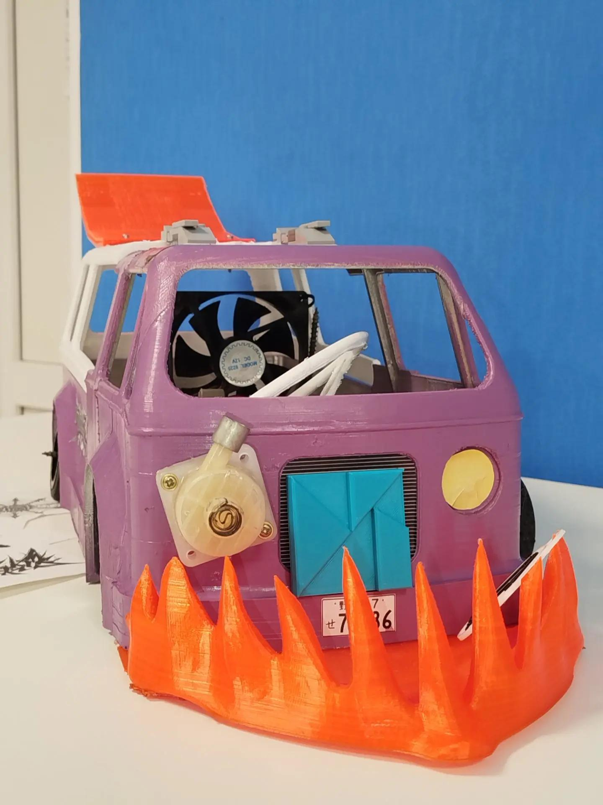
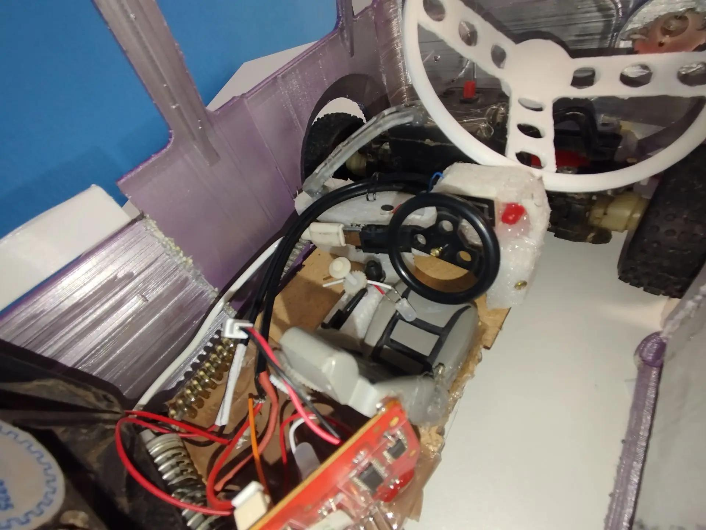

# 🚗 Smart Auto — Автомобиль будущего

Проект направления **«Инженеры транспорта»**: концепт автомобиля будущего с полностью кастомным дизайном — 3D-модели для печати, авторские наклейки и логотипы.

## 📌 Постер проекта

Главное визуальное представление проекта — **постер А3** (`Презентация/Постер/A3.png`). Файл ещё не закоммичен в репозиторий; ниже временно показан лист А4, который уже в git:


---

## 📸 Фото макета

> Папка `Фото/` пока не закоммичена в этот репозиторий — раздел подготовлен: когда файлы появятся по указанным путям, изображения отобразятся автоматически.

| Спереди | Главный вид сбоку | Внутри |
|---|---|---|
|  |  |  |

### Багажник открыт


### Боковые виды с наклейками


---

## 🖨️ STL-модели (`STL/`)

### Корпус

| Модель | Файл |
|---|---|
| Лицевая часть | [.stl](STL/Корпус/лицевая%20часть.stl) · [.3mf](STL/Корпус/лицевая%20часть.3mf) |
| Мотор, колёса, вентилятор | [.stl](STL/Корпус/мотор%2C%20колеса%2C%20вентилятор.stl) |

### Декор

| Классный спойлер | Крутой спойлер | Руль |
|---|---|---|
|  |  |  |
| [.stl](STL/декор/классный%20спойлер.stl) | [.stl](STL/декор/крутой%20спойлер%20%281%29.stl) | [.stl](STL/декор/руль%20классный%20%282%29.stl) |

### Логотипы в 3D

| logo1 | logo2 |
|---|---|
| [.stl](Наклейки/Логотип/Логотип%201/logo1.stl) | [.stl](Наклейки/Логотип/Логотип%202/logo2.stl) |

Превью логотипов — в разделе «✒️ Логотипы» ниже.

---

## 🦈 Наклейки (`Наклейки/`)

### Серия «Акула»


### Стиль Босодзоку


---

## ✒️ Логотипы (`Наклейки/Логотип/`)

### Эскизы (Рисунки)


### Логотип 1 — финальные версии


Файлы: [3dmodel.solidcraft](Наклейки/Логотип/Логотип%201/3dmodel.solidcraft) · [Sketch1.dxf](Наклейки/Логотип/Логотип%201/Sketch1.dxf) · [logo1.stl](Наклейки/Логотип/Логотип%201/logo1.stl)

### Логотип 2 — варианты и рендеры


Файлы: [logo2.solidcraft](Наклейки/Логотип/Логотип%202/logo2.solidcraft) · [logo2.stl](Наклейки/Логотип/Логотип%202/logo2.stl)

---

## 📊 Презентация (`Наклейки/Презентация/`)

Общий лист: 

Постер A4 (копия): 

Слайды 1–6:


Исходники: [Лист-презентация.figcraft](Наклейки/Презентация/Лист-презентация.figcraft) · [Лист-презентация_общая.figcraft](Наклейки/Презентация/Лист-презентация_общая.figcraft)

---

## 🗂 Структура проекта

```
.
├── README.md
├── STL
│   ├── Корпус          — лицевая часть (.stl/.3mf), мотор+колёса+вентилятор (.stl)
│   └── декор           — спойлеры, руль (.stl + превью .png)
├── Наклейки
│   ├── A4.png          — постер проекта А4 (главное изображение)
│   ├── Акула           — серия наклеек «Акула»
│   ├── Босудзоку стиль — наклейки в стиле босодзоку
│   ├── Логотип         — эскизы, SolidCraft/DXF, версии и рендеры
│   └── Презентация     — слайды 1–6, лист A4, figcraft-исходники
└── Фото                — фото макета (папка будет добавлена)
```
