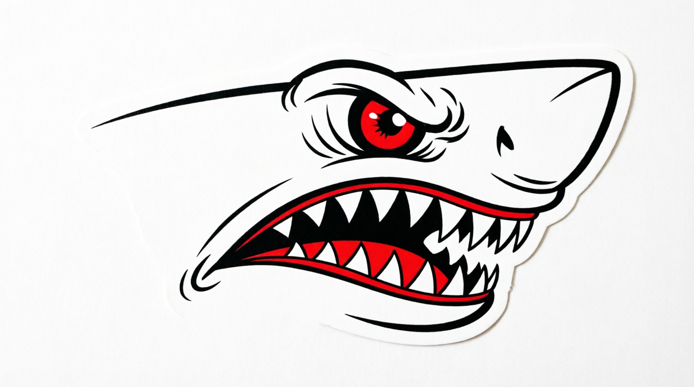
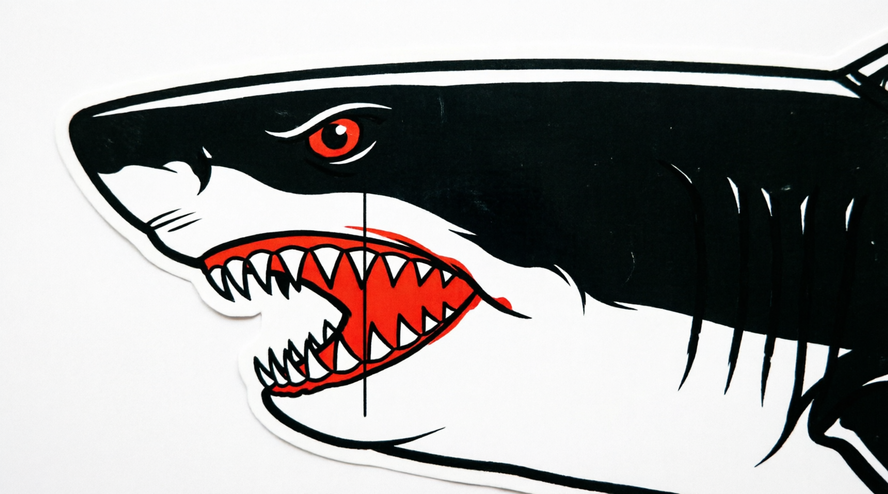
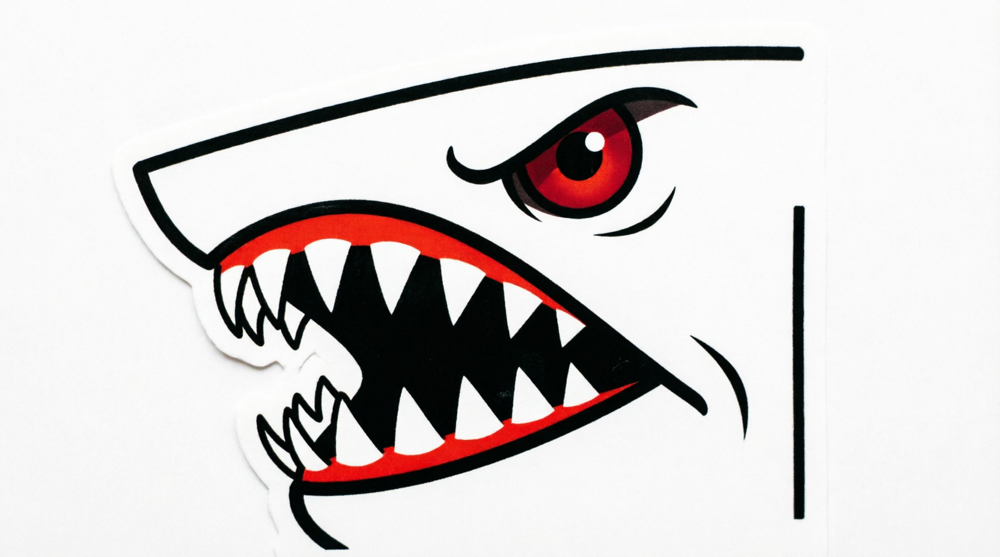
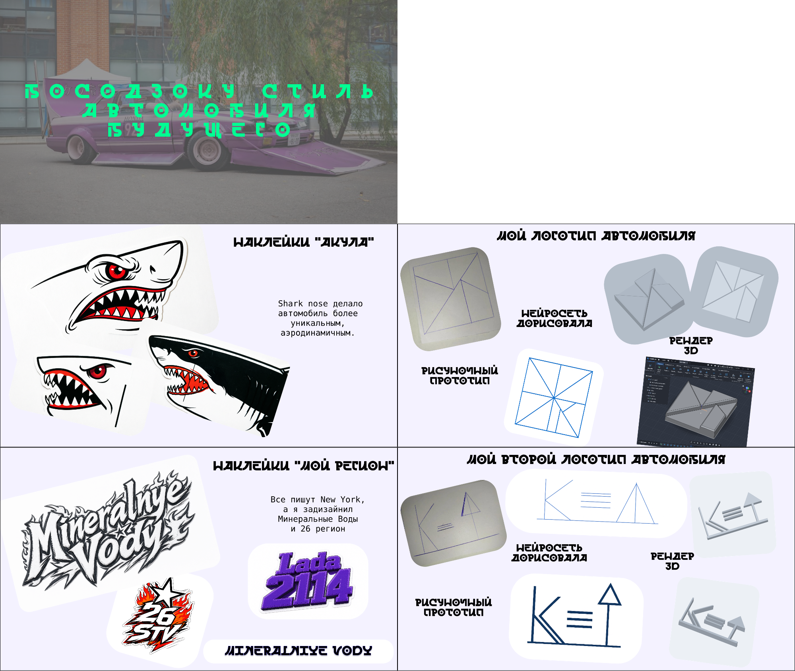
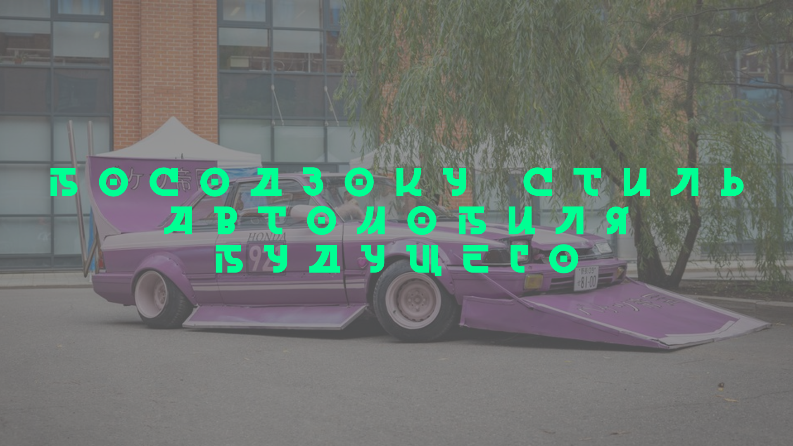
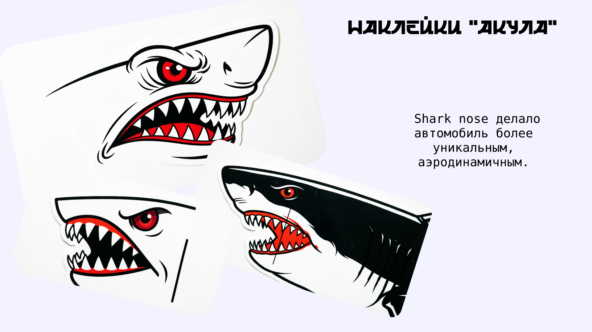
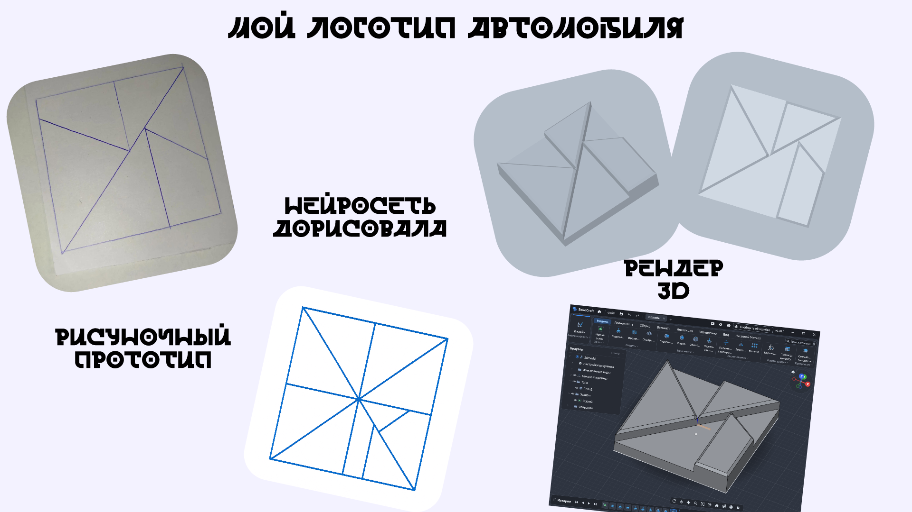
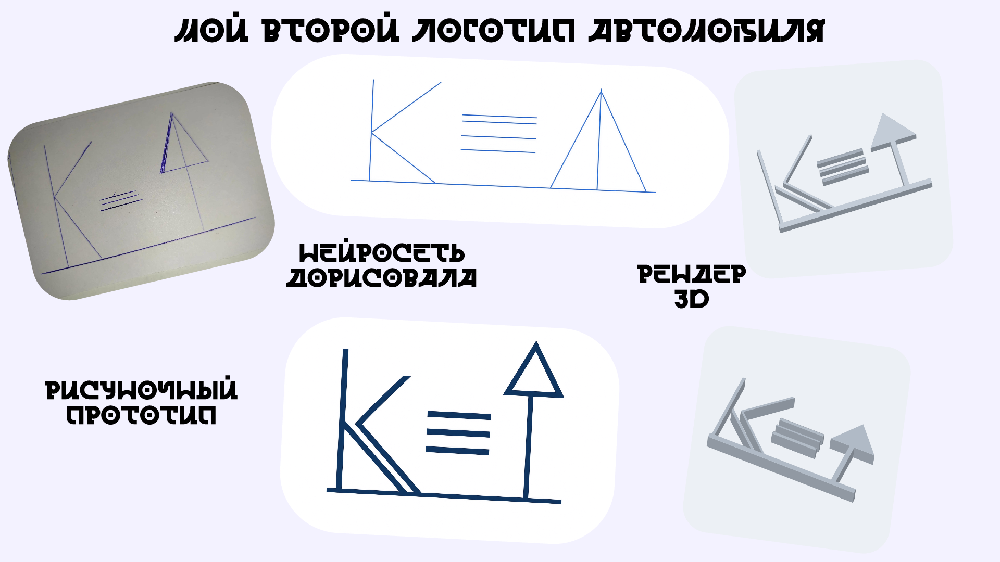
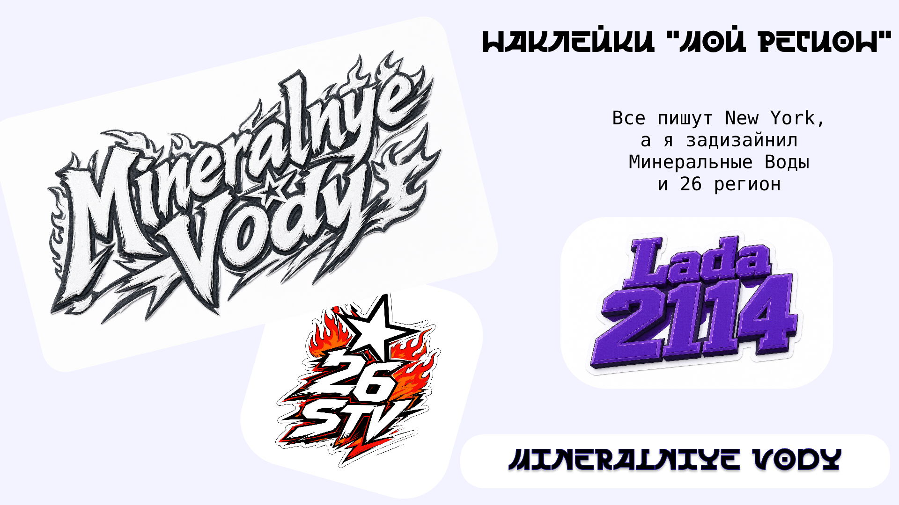

# Smart Auto 

Проект умного автомобиля с кастомным 3D-корпусом и авторским дизайном наклеек.

##  Структура проекта

```
smart_auto/
── STL/Корпус/          # 3D-модели корпуса
├── Наклейки/
│   ├── Акула/           # Наклейки с акулой
│   ├── Босудзоку стиль/ # Наклейки в японском стиле босодзоку
│   ├── Логотип/         # Логотипы проекта
│   ── Презентация/     # Презентационные материалы
└── README.md
```

## 🖨️ 3D-модели корпуса

Корпус автомобиля состоит из нескольких частей, напечатанных на 3D-принтере:

### Лицевая часть


### Мотор, колёса и вентилятор


> Файлы доступны в форматах `.stl` и `.3mf` для печати на любом 3D-принтере.

---

## 🎨 Дизайн наклеек

### 🦈 Акула

Серия наклеек с изображением акулы — символ скорости и агрессивного стиля.

| Вариант 1 | Вариант 2 | Вариант 3 |
|-----------|-----------|-----------|
|  |  |  |

---

### 🔥 Стиль Босодзоку

Наклейки в японском уличном стиле **босодзоку** — агрессивная графика, пламя, острые линии.

| Вариант 1 | Вариант 2 | Вариант 3 |
|-----------|-----------|-----------|
|  |  |  |

| Вариант 4 | Вариант 5 | Mineralnye Vody |
|-----------|-----------|-----------------|
|  |  |  |

---

### ⭐ Логотипы

#### Логотип №1

**Эскизы и концепции:**


**Финальные версии:**

| Версия 1 | Версия 2 | Версия 3 |
|----------|----------|----------|
|  |  |  |

**3D-модель логотипа:** `3dmodel.solidcraft` / `logo1.stl`

---

#### Логотип №2

| Вариант 1 | Вариант 2 |
|-----------|-----------|
|  |  |

**Рендеры:**

| Рендер 1 | Рендер 2 |
|----------|----------|
|  |  |

**3D-модель:** `logo2.solidcraft` / `logo2.stl`

---

## 📊 Презентация

Полный лист-презентация проекта:



### Слайды презентации

| Слайд 1 | Слайд 2 | Слайд 3 |
|---------|---------|---------|
|  |  |  |

| Слайд 4 | Слайд 5 |
|---------|---------|
|  |  |

> Исходные файлы презентации: `Лист-презентация.figcraft`, `Лист-презентация_общая.figcraft`

---

## 🛠️ Используемые инструменты

- **3D-моделирование:** SolidCraft
- **3D-печать:** форматы `.stl`, `.3mf`
- **Графический дизайн:** FigCraft
- **Стиль наклеек:** Босодзоку (японская уличная культура)

---

## 📝 Лицензия

© 2026 Smart Auto Project. Все права защищены.