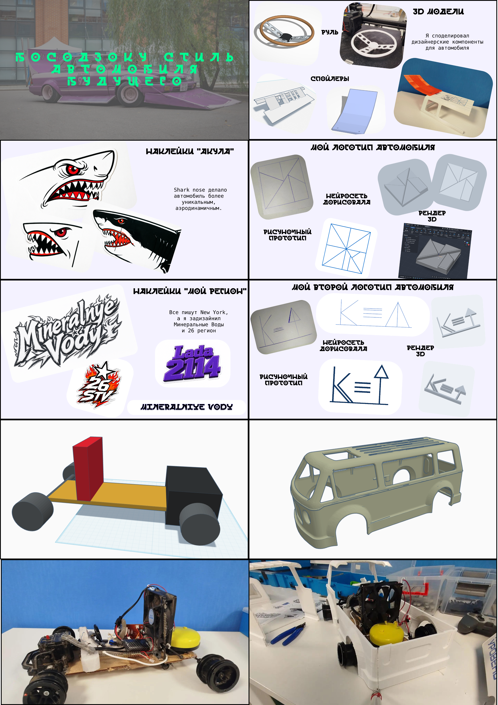
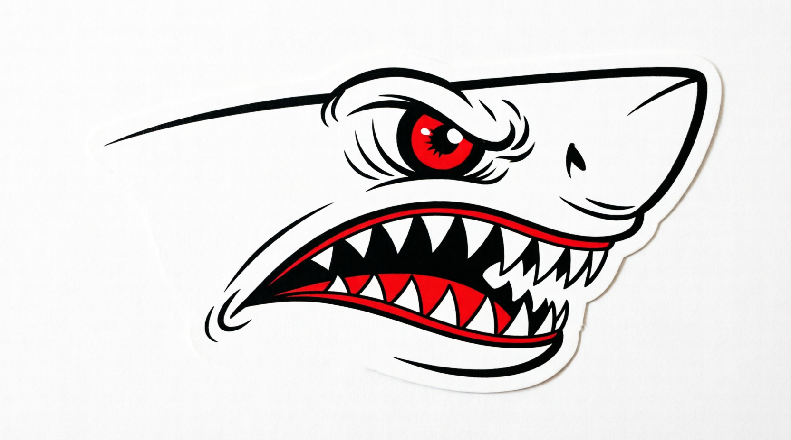
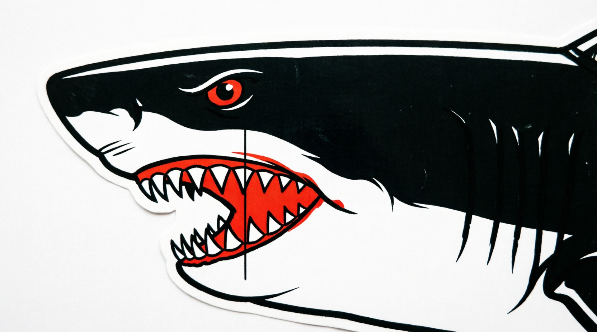
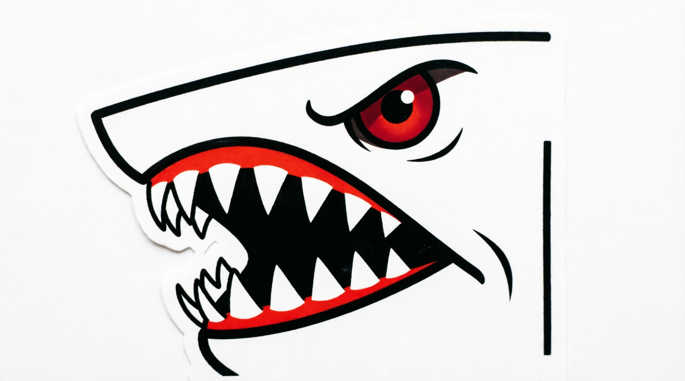
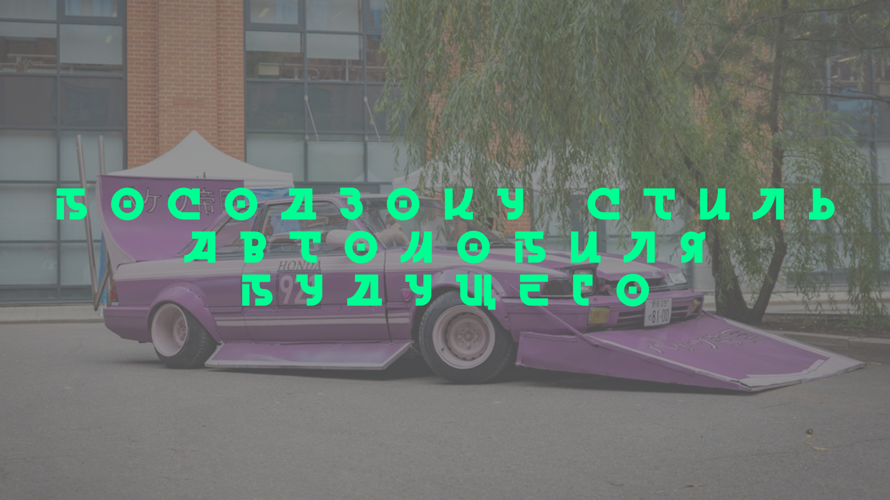
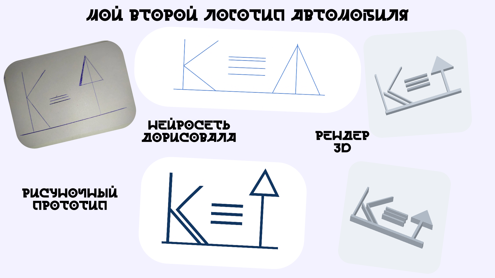
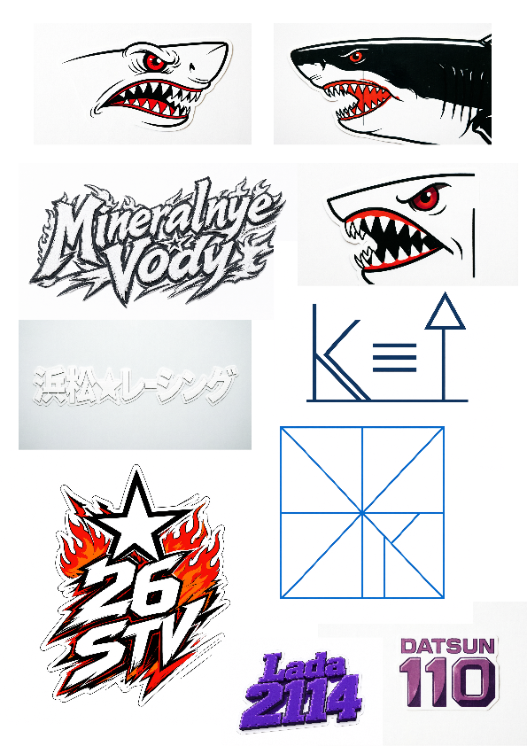

# Smart Auto 

Проект умного автомобиля с кастомным 3D-корпусом и авторским дизайном наклеек.

## 📌 Постер проекта (А4)

Главный постер проекта формата А4 — общий лист с дизайном автомобиля и наклеек:



*Файл: [`Наклейки/Презентация/A4.png`](Наклейки/Презентация/A4.png)*

##  Структура проекта

```
smart_auto/
├── STL/
│   ├── Корпус/          # 3D-модели корпуса (.stl, .3mf)
│   └── Декор/           # Спойлеры и руль (.stl + превью .png)
├── Наклейки/
│   ├── Акула/           # Наклейки с акулой
│   ├── Босудзоку стиль/ # Наклейки в японском стиле босодзоку
│   ├── Логотип/         # Логотипы проекта
│   ├── Презентация/     # Презентационные материалы и постер A4.png
│   └── A4.png           # Копия постера А4
└── README.md
```

## 🖨️ 3D-модели

### Корпус

Корпус автомобиля состоит из нескольких частей, напечатанных на 3D-принтере:

| Лицевая часть | Мотор, колёса и вентилятор |
|---------------|----------------------------|
| [📄 Скачать лицевая часть.stl](STL/Корпус/лицевая%20часть.stl) | [📄 Скачать мотор, колеса, вентилятор.stl](STL/Корпус/мотор,%20колеса,%20вентилятор.stl) |

> ⚠️ STL-файлы не отображаются как картинки в Markdown — используйте ссылки для скачивания моделей.

**Файлы корпуса:**

| Файл | Формат |
|------|--------|
| [`STL/Корпус/лицевая часть.stl`](STL/Корпус/лицевая%20часть.stl) | `.stl` |
| [`STL/Корпус/лицевая часть.3mf`](STL/Корпус/лицевая%20часть.3mf) | `.3mf` |
| [`STL/Корпус/мотор, колеса, вентилятор.stl`](STL/Корпус/мотор,%20колеса,%20вентилятор.stl) | `.stl` |

### Декор

Декоративные детали — спойлеры и руль. Для каждой модели есть картинка-превью и STL-файл:

| Классный спойлер | Крутой спойлер | Руль |
|------------------|----------------|------|
|  |  |  |
| [`классный спойлер.stl`](STL/декор/классный%20спойлер.stl) | [`крутой спойлер (1).stl`](STL/декор/крутой%20спойлер%20%281%29.stl) | [`руль классный (2).stl`](STL/декор/руль%20классный%20%282%29.stl) |

> Файлы доступны в форматах `.stl` и `.3mf` для печати на любом 3D-принтере.

---

## 🎨 Дизайн наклеек

### 🦈 Акула

Серия наклеек с изображением акулы — символ скорости и агрессивного стиля.

| Вариант 1 | Вариант 2 | Вариант 3 |
|-----------|-----------|-----------|
|  |  |  |

---

### 🔥 Стиль Босодзоку

Наклейки в японском уличном стиле **босодзоку** — агрессивная графика, пламя, острые линии.

| Вариант 1 | Вариант 2 | Вариант 3 |
|-----------|-----------|-----------|
|  |  |  |

| Вариант 4 | Вариант 5 | Mineralnye Vody |
|-----------|-----------|-----------------|
|  |  |  |

---

### ⭐ Логотипы

#### Логотип №1

**Эскизы и концепции:**

| Вариант 1 | Вариант 2 | Вариант 3 |
|-----------|-----------|-----------|
| |  |  |


**Финальные версии:**

| Версия 1 | Версия 2 | Версия 3 |
|----------|----------|----------|
|  |  |  |
| - |  | - |

**3D-модель логотипа:** `3dmodel.solidcraft` / [`logo1.stl`](Наклейки/Логотип/Логотип%201/logo1.stl) (эскиз для ЧПУ: `Sketch1.dxf`)

---

#### Логотип №2

| Вариант 1 | Вариант 2 |
|-----------|-----------|
|  |  |

**Рендеры:**

| Рендер 1 | Рендер 2 |
|----------|----------|
|  |  |

**3D-модель:** [`logo2.stl`](Наклейки/Логотип/Логотип%202/logo2.stl) (исходник: `logo2.solidcraft`)

---

## 📊 Презентация

Полный лист-презентация проекта:


### Слайды презентации

| Слайд 1 | Слайд 2 | Слайд 3 |
|---------|---------|---------|
|  |  |  |

| Слайд 4 | Слайд 5 | Слайд 6 |
|---------|---------|---------|
|  |  |  |

### Постер А4

Главный постер проекта формата А4 (также доступен в корне папки `Наклейки/A4.png`):

| Постер А4 (Презентация) | Постер А4 (Наклейки) |
|--------------------------|-----------------------|
|  |  |

> Исходные файлы презентации: `Лист-презентация.figcraft`, `Лист-презентация_общая.figcraft`

---

## 🛠️ Используемые инструменты

- **3D-моделирование:** SolidCraft
- **3D-печать:** форматы `.stl`, `.3mf`
- **Графический дизайн:** FigCraft
- **Стиль наклеек:** Босодзоку (японская уличная культура)

---

## 📝 Лицензия

© 2026 Smart Auto Project. Все права защищены.